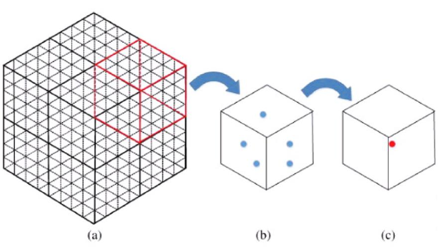

# SLAM

## SLAM 개념
- 로봇이 사전 정보나 GPS가 없는 낯선 환경에서 센서 데이터를 이용해 주변 지도를 만드는 동시에, 그 지도 속에서 자신의 현재 위치를 실시간으로 파악하는 기술
- SLAM은 mapping과 localization을 동시에 한다
- LiDAR, IMU 등을 사용

## 오도메트리(odometry)
- 센서와 자체 계산을 통해 예측한 위치
- 바퀴 엔코더가 회전을 했을 때 드리프트(바퀴 미끄러짐), 지름 오차가 적분되어 오차가 누적됨
- 각속도에 대한 오차 보정 필요
- 칼만 필터 → 확장 칼만 필터(EKF)
- 로컬라이제이션(localization)의 핵심: 스캔 매칭(scan matching)

## 스캔 매칭(scan matching)
- 새 스캔을 조금씩 이동/회전시켜 지도와 비교한다
- odom은 탐색을 시작할 근처 위치를 제공한다
- 모양이 반복되는 복도는 특정 방향의 보정이 어렵다

## map / odom / base
- odom은 연속적인 이동 추정이지만 장기 오차가 쌓인다
- map은 전체 지도에 맞게 보정되어 위치가 바뀔 수 있다
- base_footprint는 바닥 기준, base_link는 본체 기준이다
- map → odom → base_footprint → base_link 순서 (반대 방향으로 상위이다)

## Cartographer 파라미터
- 스캔 분할
- voxel 필터
- correlative
- ceres
- motion filter
- submap
- odometry

### submap
- 로봇이 사방을 돌아다니며 지도를 그릴 때(SLAM), 한 번에 거대한 지도를 모두 업데이트하면 연산량이 너무 많아진다. 이를 해결하기 위해 전체 공간을 작은 구역 단위로 나누어 작성한 부분 지도를 서브맵이라 한다.

### voxel 필터
- 3D 포인트 클라우드에서 가까이 모여 있는 점들을 일정한 크기의 3차원 격자(voxel)로 묶어 대표점을 남기는 필터



- 목적: 데이터 수를 줄여 계산량 감소
- voxel 크기가 작으면: 세부 정보가 잘 보존되지만 계산량이 증가
- voxel 크기가 크면: 계산은 빠르지만 작은 물체나 구조가 사라질 수 있음

## 실습 핵심값
- ROS에는 토픽 리매핑이 있어, 센서를 2개 사용할 시 분리해서 사용 가능
- 라이다 2개 사용 시 하나의 데이터로 정합하는 노드를 따로 만드는 게 좋음

### TF 구성
- Gazebo: odom 기준 base_footprint의 연속 이동을 발행
- Cartographer: map 기준 odom의 보정을 발행
- tracking

### 입력 점검
```bash
ros2 topic hz /scan
ros2 topic hz /odom
ros2 topic echo /clock --once
ros2 run tf2_ros tf2_echo odom base_footprint
```
