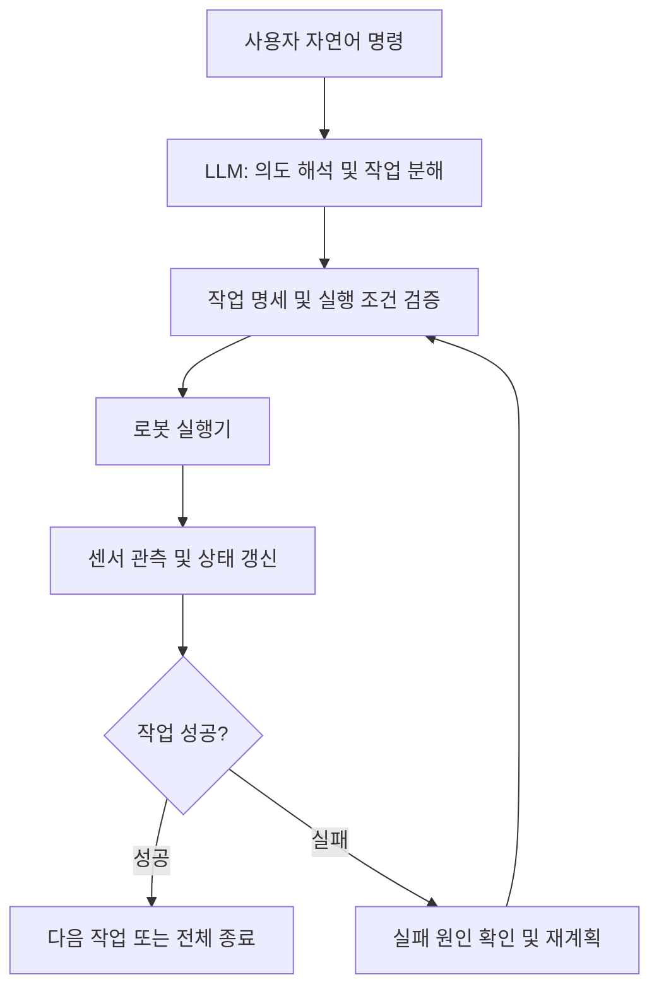
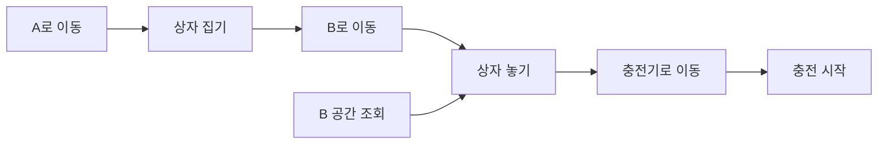
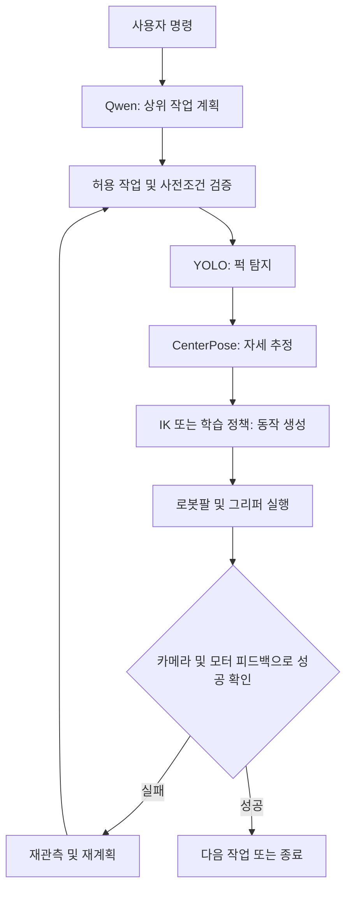

# TIL — 12강. 자연어를 하위 작업으로 바꾸기

> 자연어 명령을 실행 가능한 하위 작업으로 분해하고, 작업의 순서와 실행 조건을 검증하며, 실제 결과에 따라 계획을 수정하는 방법을 학습했다.

- 학습일: 2026-11-25
- 출처: KANT Physical AI 12강 「자연어를 하위 작업으로 바꾸기」, 총 25페이지
- 구분: 본문은 강의자료 기반 정리이며, 마지막 프로젝트 적용 예시는 개인 학습을 위한 확장이다.

## 1. 자연어 명령을 로봇 행동으로 변환하기 (p.2~5)

사용자 명령: **“A에서 상자를 가져와 B에 놓고 충전해.”**

자연어에는 대상, 목적지, 행동 순서, 종료 조건이 생략되거나 모호하게 표현될 수 있다. 따라서 LLM의 출력이 곧바로 로봇 명령이 되어서는 안 된다.



- **Task Planning**: 목표를 달성하기 위한 작업 계획을 세우는 과정.
- **Task Decomposition**: 큰 목표를 실행 가능한 하위 작업으로 나누는 과정.
- **Grounding**: 자연어 표현을 현재 관측된 실제 대상이나 상태에 연결하는 과정.

예를 들어 A에 빨간 상자가 두 개 있다면 색상만으로 대상을 확정할 수 없다. 사용자에게 입구 쪽과 창가 쪽 중 어느 상자인지 묻고, 답변을 관측 목록과 대조해 `box_02`를 선택한다.

### 작업 명세 (Task Specification)

LLM과 실행기는 다음과 같은 구조화된 데이터를 주고받을 수 있다.

```json
{
  "id": "t2",
  "op": "pick",
  "object_id": "box_02",
  "after": ["t1"]
}
```

| 필드 | 의미 |
|---|---|
| `id` | 중복되지 않는 작업 식별자 |
| `op` | 실행할 행동. 허용 목록에 있어야 한다. |
| `object_id` | 관측 목록에서 확인된 대상의 ID |
| `after` | 먼저 완료되어야 하는 작업 ID 목록 |

## 2. 작업 의존성과 DAG (p.8~12)

**DAG(Directed Acyclic Graph, 방향성 비순환 그래프)**는 작업 간 선후 관계를 순환 없이 표현하는 그래프다.



상자 놓기는 `B로 이동`과 `B 공간 조회`가 모두 완료되어야 진행할 수 있다. 단, 공간 조회가 완료되었다는 사실만으로 공간이 비어 있다고 단정하면 안 된다. 실제 조회 결과가 `true`이고 현재도 유효해야 한다.

| 작업 ID | 실행 내용 | 선행 작업 |
|---|---|---|
| `A` | A로 이동 | 없음 |
| `check` | B 공간 조회 | 없음 |
| `pick` | 상자 집기 | A |
| `B` | B로 이동 | pick |
| `place` | 상자 놓기 | B, check |
| `D` | 충전기로 이동 | place |
| `charge` | 충전 시작 | D |

### 위상 정렬 (Topological Sort)

작업 간 의존성을 위반하지 않는 실행 순서를 계산하는 알고리즘이다. 남아 있는 선행 작업이 0개인 노드부터 처리한다.

예를 들어 `place`의 남은 선행 작업 수는 처음에 2개이고, `check`가 완료되면 1개, `B`까지 완료되면 0개가 된다.

### 순환 오류 (Cycle Error)

`A`가 `place`를 기다리도록 잘못 지정하면 `A → pick → B → place → A`라는 순환이 생긴다. 이 작업들은 서로의 완료를 기다리게 되어 정상 실행할 수 없다. 잘못 추가된 `place → A` 의존성을 제거해야 한다.

### 병렬 실행과 자원 충돌

의존성이 없는 작업이라도 동일한 하드웨어를 동시에 사용하면 실행할 수 없다. 강의 예시에서는 고정 카메라의 B 공간 조회와 차체의 A 이동을 병렬로 처리할 수 있지만, 차체 하나가 A와 D로 동시에 이동할 수는 없다.

## 3. Python 실습 (p.20~21, 23)

Python 3.9 이상에서 표준 라이브러리 `graphlib`를 사용할 수 있다. 강의 실습에 D와 charge를 추가했다.

```python
from graphlib import TopologicalSorter, CycleError

plan = {
    "A": (),
    "check": (),
    "pick": ("A",),
    "B": ("pick",),
    "place": ("B", "check"),
    "D": ("place",),
    "charge": ("D",),
}

print(tuple(TopologicalSorter(plan).static_order()))

broken = dict(plan, A=("place",))

try:
    tuple(TopologicalSorter(broken).static_order())
except CycleError as err:
    print("순환 오류:", err.args[1])
```

실행 결과:

```text
('A', 'check', 'pick', 'B', 'place', 'D', 'charge')
순환 오류: ['A', 'pick', 'B', 'place', 'A']
```

유효한 위상 정렬 결과는 여러 개일 수 있다. 예를 들어 `check`를 `A`보다 먼저 수행해도 의존성을 위반하지 않는다.

**주의:** `TopologicalSorter`는 순환을 검사하지만, 선행 작업 목록에만 등장하는 미등록 ID도 노드로 받아들인다. 작업 ID의 유효성, 물리적인 실행 가능성, 자원 충돌은 별도로 검증해야 한다. 위상 정렬이 성공했다고 실제 로봇 행동이 성공하는 것은 아니다.

## 4. 상태, 사전조건, 효과, 관측 (p.3, 6~7, 13)

| 용어 | 의미 | 집기 예시 |
|---|---|---|
| State | 현재 로봇과 환경의 상태 | 로봇은 A에 있고 손은 비어 있음 |
| Precondition | 행동 실행 전 만족해야 하는 조건 | 손이 비어 있고 물체가 작업 범위에 있음 |
| Action | 수행하는 행동 | `pick(box_02)` |
| Effect | 행동 성공 시 기대되는 상태 변화 | `holding(box_02)` |
| Observation | 센서로 실제 확인한 결과 | 상자가 그리퍼에 들려 있는지 확인 |

그리퍼 닫기 명령이 완료되어도 상자가 작업대에 남아 있다면 집기는 실패한 것이다. **명령 전송 완료와 실제 작업 성공을 구별해야 한다.**

### 3가지 관측 상태

| `free(B)` | 의미 | 대응 |
|---|---|---|
| `true` | 빈 공간을 확인함 | 관측의 최신성 확인 후 진행 |
| `false` | 다른 물체가 공간을 점유함 | 대기 또는 사용자 문의 |
| `unknown` | 시야가 가려져 판단할 수 없음 | 재관측 |

관측하지 못한 상태를 `false`로 바꾸면 정보가 사라진다. `unknown`은 별도로 관리해야 한다.

### 전체 종료 조건

- 선택한 상자가 B에 있고 로봇의 손이 비어 있어야 한다.
- 충전기 D에 연결되고 실제 충전 중 신호가 확인되어야 한다.
- 상자를 B에 놓은 이후에 충전을 시작해야 한다.

강의에서는 배터리 완충이 아니라 **충전 시작 확인**을 종료 조건으로 정했다.

## 5. 작업 계획 방법 비교 (p.14)

| 구분 | 상태 공간 탐색 (State Space Search) | 작업 분해 (Task Decomposition) |
|---|---|---|
| 출발점 | 현재 상태 | 상위 목표 |
| 방법 | 현재 가능한 행동과 다음 상태를 탐색 | 큰 작업을 작은 작업으로 나눔 |
| 손에 다른 상자가 있는 경우 | 새 상자 집기를 제외하고 기존 상자를 임시 보관할 수 있는지 탐색 | 집기의 사전조건이 충족되지 않으므로 임시 보관 하위 작업 추가 검토 |

안전하고 허용된 임시 보관 위치가 없다면 어느 방법이든 진행을 중단하고 필요한 정보를 확인해야 한다.

## 6. 재계획과 피드백 (p.15~16)

집기 실패로 상자가 옆으로 밀렸더라도 A에 도착했다는 사실이 여전히 유효하다면 처음부터 모든 작업을 반복할 필요는 없다.

1. 실패한 작업과 실제 관측 상태를 확인한다.
2. 상자의 변경된 위치와 자세를 재측정한다.
3. 집기 목표를 다시 계산하고 실행한다.
4. 파지가 확인되면 B로 이동한다.

B가 막혀 있고 옆 선반 C가 비어 있더라도 사용자 승인 없이 목적지를 C로 바꾸면 안 된다. B를 재관측하고 대기하거나 사용자에게 C 사용 여부를 문의한다.

## 7. 실제 연구 사례 (p.17~18)

### SayCan (2022)

Ahn et al., *Do As I Can, Not As I Say: Grounding Language in Robotic Affordances*.

사용자가 음료를 쏟고 닦을 물건을 요청했을 때, LLM이 판단한 행동의 관련성과 현재 로봇이 해당 행동을 실행할 가능성을 결합하여 스펀지를 찾고 가져오는 등의 행동을 선택한다.

- 언어 관련성: 사용자 목표에 적합한 행동인가?
- 실행 가능성(Affordance): 현재 상태에서 수행할 수 있는 행동인가?
- 결합 점수: 두 조건을 함께 고려하여 다음 행동을 선택한다.

### Inner Monologue (2022)

Huang et al., *Inner Monologue: Embodied Reasoning through Planning with Language Models*.

로봇의 행동 결과를 피드백으로 LLM에 전달하여 이후 행동을 다시 결정하는 방법이다. 강의에서는 서랍 열기 및 캔 넣기에 실패한 이후 해당 행동을 다시 시도하는 사례를 보여준다.

| 연구 | 핵심 질문 |
|---|---|
| SayCan | 지금 이 행동을 실행할 수 있는가? |
| Inner Monologue | 실제 행동 결과를 보고 다음에 무엇을 해야 하는가? |

## 8. 복습 문제 및 풀이 (p.19~25)

| 상황 | 멈춰야 하는 이유 | 해결 방법 |
|---|---|---|
| 빨간 상자가 두 개 | 대상이 모호함 | 사용자 답변과 관측으로 ID 확정 |
| 지도에 없는 Z를 지정 | 위치를 확인할 수 없음 | 위치 또는 유효한 목적지 문의 |
| A가 place를 기다림 | 작업 의존성의 순환 | 잘못된 간선 수정 후 위상 정렬 |
| pick이 미등록 t9를 기다림 | 잘못된 선행 ID | 참조 ID 별도 검사 |
| 손이 비어 있는데 place 실행 | 파지 사전조건 불충족 | 물체를 실제로 집었는지 확인 |
| 그리퍼는 닫혔지만 물체가 탁자에 있음 | 기대 효과와 실제 결과 불일치 | 물체 재관측 및 집기 재시도 |
| A와 D로 동시 이동 | 차체 자원 충돌 | 실행 시간 분리 |

강의 제출물: 작업 그래프 한 장, 정상 및 순환 입력의 실행 결과, 상자를 구별하는 질문 한 문장.

## 9. 내 로봇 프로젝트에 적용 (개인 학습 확장)

> [추론 · 미검증] 다음은 강의 개념을 기존 로봇팔 개발에 적용한 설계 예시다. 실제 통합 및 성능은 검증하지 않았다.

사용자 명령: “사각형 퍽을 집어서 회전판에 넣어.”



LLM을 기존 강화학습 제어기의 대체재로 쓰기보다, 상위 목표를 분해하고 검증된 스킬을 선택하는 계획기로 사용하는 방법을 생각해 볼 수 있다. IK와 PPO의 결합 방식은 기존 구현에 맞게 결정해야 한다. 모터 전류 등의 텔레메트리는 파지를 간접적으로 추정하는 정보이며, 단독으로 파지 성공을 보장하지 않는다.

## 10. 오늘 배운 점

- 자연어를 실제 로봇 행동으로 바꾸려면 대상과 목표를 명확히 하고 실행 가능한 작업으로 분해해야 한다.
- DAG와 위상 정렬은 작업 순서를 해결하지만, 물리적 실행 가능성과 실제 성공 여부까지 해결하지는 않는다.
- 센서로 확인한 실제 상태를 다음 작업의 사전조건에 반영해야 한다.
- 실패 시 모든 작업을 반복하기보다 유효한 상태를 유지하고 필요한 부분만 재계획하는 것이 합리적이다.
- LLM의 계획 능력과 로봇의 물리 제어 능력을 구분하는 것이 중요하다.

**한 줄 정리:** 자연어 → 작업 분해 → 의존성 및 실행 조건 검증 → 행동 실행 → 실제 결과 관측 → 다음 작업 또는 재계획.
